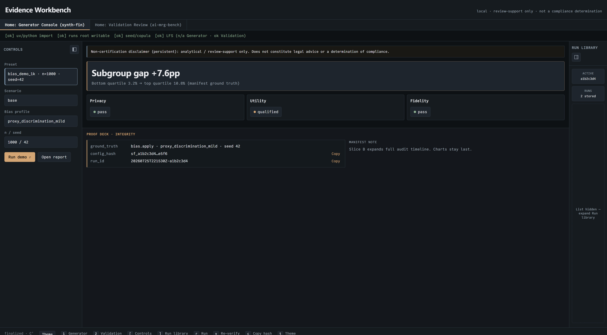
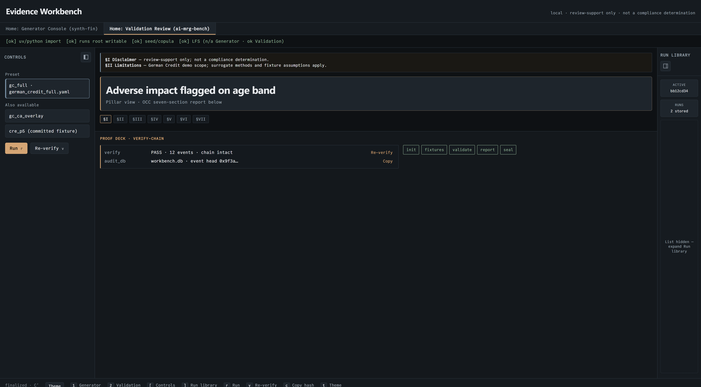

# Evidence Workbench

A review instrument for credit models. It runs the bias, drift, and fairness tests an independent validator would run, then shows the evidence behind every result: the metrics, the report section they belong to, and the audit chain binding them together. **No run displays a passing status unless its audit chain verifies.**

It runs locally and drives two engines — [`synth-fin`](https://github.com/sls00/synth-fin) generates the test panel, [`ai-mrg-bench`](https://github.com/sls00/ai-mrg-bench) validates the model against it — presenting both in one place. Their CLIs stay canonical; this shell never recomputes or restates their numbers.



<p align="center"><sub><b>Generator Console</b> — building the synthetic loan panel a validation run will be tested against, with privacy and fidelity checks shown as they complete.</sub></p>



<p align="center"><sub><b>Validation Review</b> — the OCC seven-section report with section navigation, and a proof deck that re-verifies the audit chain on demand.</sub></p>

Want to read the output without installing anything? [`ai-mrg-bench/docs/examples/`](https://github.com/sls00/ai-mrg-bench/tree/main/docs/examples) has a committed validation report and its audit-chain verification.

## What this is / is not

| Is | Is not |
| --- | --- |
| A local FastAPI + Vite/React shell | A multi-tenant GRC SaaS product |
| An orchestrator that embeds the engines' own reports | A second implementation of their metrics |
| Two homes in one tool: Generator and Validation | A compliance determination of any kind |

## Quick start

```bash
uv sync --group dev
uv run evidence-workbench --home generator --fake-runners
# → http://127.0.0.1:8765/?home=generator
# On WSL, binds 0.0.0.0 by default so Windows can reach it.
# See docs/wsl-cursor-browser.md if your browser can't connect.
```

Hot-reload UI (API already running on `:8765`):

```bash
cd web && npm ci && npm run dev
```

Real engines (siblings keep their own uv envs):

```bash
export SYNTH_FIN_ROOT=../synth-fin AI_MRG_BENCH_ROOT=../ai-mrg-bench
uv run evidence-workbench --home generator
```

## Deep-links

With `evidence-workbench` on `PATH`:

```bash
synth-fin ui    # Generator Console
workbench ui    # Validation Review
```

PATH `exec` only — **no** reverse import from the SDKs.

## Layout

```
src/evidence_workbench/   # FastAPI, runners, locks, index, preflight
web/                      # Vite + React + TS (DESIGN.md tokens)
tests/                    # pytest API smoke (fake runners)
web/e2e/                  # Playwright golden paths (Slice B)
vendor/design/            # finalized.html + lock meta (CI-checked)
docs/                     # architecture + README imagery
```

## Status & runs

- `$EVIDENCE_RUNS_ROOT` default `./.evidence-runs/` (gitignored)
- Namespaces: `synth-fin/` · `ai-mrg-bench/` · single `index.jsonl`
- Run: `POST /api/runs` → **202** + poll; cancel → `incomplete`
- Status law: `ok` \| `failed` \| `qualified` \| `incomplete`

## Tests / CI

```bash
EVIDENCE_FAKE_RUNNERS=1 uv run pytest -q
cd web && npm ci && npm run build
cd web && npm run test:e2e   # installs Chromium if needed, then golden paths
```

First Playwright run downloads browser binaries to `~/.cache/ms-playwright/` (or run `npm run test:e2e:install`). GitHub Actions: Python smoke, web build, Playwright (fake), design-lock sha256 check.
Playwright runs inside the runner against `127.0.0.1` (not Windows Cursor browser). Optional `@real-engines` is local/nightly only (B5).

## Design locks

- `DESIGN.md` — tokens, typography (Cabinet + Commit Mono), motion
- `vendor/design/finalized.html` — Slice A chrome SoT (sha256 pinned in CI)
- Do not redesign fonts/colors/layout without explicit approval

## Docs

- [Architecture overview](docs/architecture/overview.md)
- [WSL + Cursor IDE browser](docs/wsl-cursor-browser.md)
- [Contributing](CONTRIBUTING.md)
- [Security](SECURITY.md)
- Deferred post–Slice A work: [TODOS.md](TODOS.md)

## License

[Blue Oak Model License 1.0.0](https://blueoakcouncil.org/license/1.0.0) — Copyright © 2026 Steven L. Sorenson. See [`LICENSE`](LICENSE).
